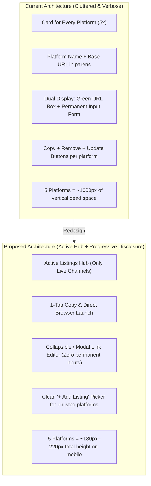

# Marketplace Links Mobile Redesign: Active Listing Hub

## Problem Statement
**How might we** redesign the external marketplace links section on the staging product detail view so that store managers can track, open, and 1-tap copy active resale listings (Wallapop, Vinted, Milanuncios, etc.) on narrow mobile viewports (`320px`–`360px`) without visual clutter, redundant inputs, or endless scrolling?

---

## The Core Problem: Why the Current UI Breaks on Mobile

### Key Diagnosis
1. **Unlisted Platform Inflation**: If 5 platforms are configured in the database, even if only 1 is listed, all 5 render full forms with text inputs and black buttons, forcing the user to scroll through ~1000px of empty inputs on a `360×800` screen.
2. **Double URL Rendering**: When a listing is saved, it renders the URL in an active link block, and *immediately below it* in a pre-filled `<input type="url">` with an "Update" button.
3. **Friction for the #1 Mobile Action**: When a manager is on WhatsApp chatting with a buyer, they need to **copy the link in 1 tap**. Right now, the "Copy URL" button is buried inside a nested gray box between URL text and delete forms.
4. **Base URL Noise**: Parenthetical URLs like `(https://es.wallapop.com)` wrap and truncate awkwardly on narrow Android devices (e.g. OPPO A74).

---

## Recommended Direction: Active Listing Hub with Progressive Disclosure

### 1. Active Listings (Where the item is currently live)
- Rendered as **compact, tactile platform tiles**:
  - **Header**: Platform brand chip + active pulse dot + click badge (`14 clicks`).
  - **Quick Action Bar (Finger-friendly >= 40px tap targets)**:
    - `📋 Copiar Enlace` (instant clipboard copy with inline "¡Copiado! ✓" badge feedback).
    - `↗ Ver` (opens external marketplace in new tab).
    - `⚙️` / `⋯` (triggers the Link Management Modal/Sheet to update URL or delete).
  - The raw URL string is truncated to a clean domain preview or hidden behind the platform name.

### 2. Progressive Disclosure for Unlisted Platforms
- Unlisted platforms **do not render empty input boxes**.
- Instead, a single compact action button appears below the active listings:
  `[ ➕ Vincular Marketplace / Add Listing Link ]`
- Tapping this button opens a clean modal sheet:
  - **Platform Selector**: Clean pills or select dropdown containing only the unlisted platforms.
  - **URL Input**: Clean, full-width `<input type="url">` with a "Paste from Clipboard" helper button.
  - **Save Button**: `[ Vincular Enlace / Save Link ]`.

### 3. Zero-Listing Empty State
- When a product is not listed on any platform yet:
  - A friendly, compact empty state:
    > *No marketplace links active yet.*
    > `[ ➕ Vincular Marketplace ]`

---

## Technical & Interface Architecture (`/api-and-interface-design`)

### 1. Zero Backend Schema Changes
- Maintains 100% compatibility with existing `ProductListingLink` and `MarketplaceSite` models.
- Reuses the existing POST endpoint `product_manage_link_view` (`action="save"`, `action="delete"`, `site_id`, `url`).

### 2. Clean Progressive Enhancement
- Works with or without JavaScript:
  - Default: Standard POST form inside a semantic accessible modal dialog (`#addListingModal` and `#editListingModal`).
  - Enhanced: 1-click clipboard copy with tactile notification ("¡Copiado!"), plus clean modal backdrop.

### 3. Context Separation
- Update `product_detail_view` context to provide:
  - `active_listing_links`: The links currently active for this product with their site metadata.
  - `unlinked_sites`: The active `MarketplaceSite` objects not yet linked to this product.
  - Keeps template rendering lightning fast and clean without inline filtering loops.

---

## Assumptions & Risk Audit

| Assumption | Risk Level | Validation / Mitigation |
| :--- | :---: | :--- |
| **Managers rarely need to edit a URL once linked** | Low | Hiding the input behind an edit icon (`⚙️`/`✏️`) removes 80% of vertical clutter without hindering updates. |
| **Copying link is the #1 mobile action** | Low | Confirmed by user feedback: large 1-tap copy button with instant visual feedback. |
| **All platforms modal selector is faster than 5 open inputs** | Low | Picking from a dropdown takes 2 taps and eliminates hundreds of pixels of wasted mobile height. |
| **Narrow mobile viewports (320px–360px OPPO A74)** | Medium | Button row uses `flex-1 min-w-0` and compact icon+label pairs that fit comfortably down to 320px. |

---

## MVP Scope

### In Scope:
1. **Active Listing Tiles**: Single compact card per active link with brand name, click counter badge, 1-tap copy button (`min-h-[40px]`), direct external link (`↗ Ver`), and settings button (`⚙️`).
2. **Add Listing Modal / Sheet**: Accessible dialog (`#addListingModal`) with platform selector (showing only unlinked sites), URL input, paste helper, and save button.
3. **Edit / Delete Modal**: Reusable modal (`#editListingModal`) triggered from the settings button allowing URL update or one-click removal.
4. **Context Optimization**: Pass `active_listing_links` and `unlinked_sites` from view to template.
5. **Bilingual Localization**: English and Spanish translations for all new modal and button labels.
6. **Playwright & Unit Tests**: Verified against OPPO A74 `360×800` and `320×711` viewports with zero horizontal overflow.

### Not Doing (and Why):
- **No live web scraping of marketplace metadata**: Fragile, slows down staging, and risks IP blocks.
- **No deep app-scheme routing (`wallapop://`)**: Unreliable across different OS versions; HTTPS links launch native apps automatically if registered.
- **No multi-column desktop-only table rewrite**: Card/tile layout scales gracefully from 320px mobile up to 1440px desktop.
