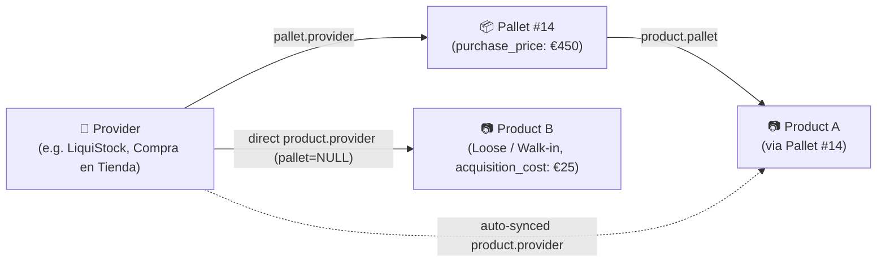

# Product Origins & Providers (Co-Living with Pallets)

## Problem Statement
How might we track the true commercial origin (`Provider`) and profitability (ROI) of every product in Rápido Pack — across both bulk liquidation pallets and direct/walk-in acquisitions — while keeping mobile intake to a single sticky tap on narrow `360×800` / `320×711` screens?

## Recommended Direction
Implement a **Cascading Origin Hierarchy (`Provider → Pallet → Product` and `Provider → Product`)** that enhances pallet tracking rather than replacing it:

1. **Data Model & Automatic Sync Invariant (`inventory/models.py`)**:
   - Introduce `Provider` with `name`, `slug`, `provider_type` (`WHOLESALER` / *Mayorista o Liquidación*, `WALK_IN` / *Compra en Tienda / Particular*, `OTHER` / *Otro*), `notes`, `is_active`, and audit timestamps.
   - Seed a default built-in provider **"Compra en Tienda / Particular"** (`provider_type=WALK_IN`) via data migration so walk-in citizen buyouts use a single structured origin without bloating the provider list.
   - Add `provider = ForeignKey(Provider, null=True, blank=True, on_delete=models.SET_NULL)` to both `Pallet` and `Product`.
   - **Golden Sync Invariant**: Whenever `product.pallet` is assigned, `product.provider` automatically inherits `pallet.provider` in `Product.save()` (and cascades via signal/save when a Manager updates `Pallet.provider`). When `product.pallet` is `None`, `product.provider` stores the direct non-pallet origin.
   - Add an optional Manager-only `acquisition_cost` (`DecimalField`, €) on `Product` for non-pallet items so direct walk-in buyouts and loose wholesale items have accurate cost attribution. If a product is assigned to a `Pallet`, `acquisition_cost` is ignored in Provider total cost aggregation so costs are never double-counted.

2. **One-Tap Sticky Origin Selector on Mobile Intake (`inventory/templates/inventory/intake.html`)**:
   - Upgrade the Pallet dropdown on `/intake/` into a unified **`OriginChoiceField`** using `<optgroup>`:
     - **📦 Pallets (`pallet:<id>`)**: e.g. `Pallet #14 (2026-11-10) · LiquiStock`
     - **🏷️ Origen Directo — Sin Pallet (`provider:<id>`)**: e.g. `🏪 Compra en Tienda / Particular`, `🏢 LiquiStock (Suelto)`
     - **— Sin especificar (`none`)**
   - Persist `request.session["last_intake_origin"]` (`pallet:<id>`, `provider:<id>`, or `none`, maintaining backwards compatibility with `last_intake_pallet_id`) so cataloging consecutive items from either a pallet or a direct provider requires zero extra taps.
   - All acquisition costs (`Pallet.purchase_price` and `Product.acquisition_cost`) remain strictly **Manager-only** and hidden from Sourcing Assistants during `/intake/`.

3. **Unified Pallets & Providers Hub (`/pallets/`) & Dashboard Filtering**:
   - Upgrade `/pallets/` into a unified **Pallets & Providers (`📦 Pallets y Proveedores`)** Manager workspace with tabs/sections for **Pallets** and **Providers**, keeping the top navigation bar compact on `360×800` and `320×711` viewports.
   - **Provider ROI & Performance Metrics** (Manager-only):
     - **Total Cost (€)**: $\sum \text{Pallet.purchase\_price} + \sum_{\text{pallet IS NULL}} \text{Product.acquisition\_cost}$
     - **Realized Revenue (€)**: $\sum_{\text{is\_sold=True}} \text{Product.sale\_price}$
     - **Active Catalog Value (€)**: $\sum_{\text{is\_sold=False}} (\text{Product.sale\_price or Product.estimated\_resale\_price})$
     - **Net Margin / ROI**: Realized Revenue minus Total Cost, alongside Pallets count, Active items count, and Sold items count.
   - On `/dashboard/`, add a **Provider filter (`?provider=<id>`)** alongside the existing Pallet filter, and display a unified origin badge on product cards (`📦 Pallet #14 · LiquiStock` or `🏪 Compra en Tienda`).

## Key Assumptions to Validate
- [x] **Cost Visibility Boundary**: `Product.acquisition_cost` is strictly Manager-only (editable in Product Detail `/products/<pk>/` and Django Admin, never exposed to Sourcing Assistants on `/intake/`).
- [ ] **Single-Dropdown Usability on OPPO A74 (`360×800` & `320×711`)**: Grouping active pallets and direct providers into one `<select>` with `<optgroup>` keeps intake selection to 1 tap without horizontal overflow or text clipping.
- [ ] **No Double-Counting in Provider ROI**: Products belonging to a Pallet derive their cost from `Pallet.purchase_price`; only standalone products (`pallet__isnull=True`) contribute `Product.acquisition_cost` to the Provider's total cost.

## MVP Scope
- **`Provider` Model & Seed Migration**: `Provider` model (`name`, `slug`, `provider_type`, `notes`, `is_active`, `created_by`, `created_at`, `updated_at`) + seeded *"Compra en Tienda / Particular"* provider + registration in `manager_admin_site`.
- **`Pallet.provider`, `Product.provider` & `Product.acquisition_cost`**: Schema & data migrations, automatic `Pallet.provider -> Product.provider` synchronization, and Manager-only `acquisition_cost` field on `ProductUpdateForm`.
- **Unified Sticky Origin Picker on `/intake/`**: `<optgroup>` selector combining active Pallets and active Providers with sticky session state.
- **Unified `/pallets/` Hub (Pallets & Providers)**: Create/edit/delete Providers, assign Provider to Pallets, and view Provider ROI & performance cards alongside Pallet cards.
- **Dashboard & Product Detail Integration**: Filter catalog by `?provider=<id>`, edit Provider/Pallet/Acquisition Cost in `/products/<pk>/`, and render origin badges on product cards and detail headers.
- **Bilingual Localization & Tests**: Full ES/EN translations (`django.po` / `django.mo`) and comprehensive test suite.

## Not Doing (and Why)
- **Not creating a separate `Provider` row per individual walk-in citizen** — Would flood the mobile `<select>` dropdown with hundreds of one-off names; individual seller references belong in product notes under the single *"Compra en Tienda / Particular"* provider.
- **Not exposing `acquisition_cost` on `/intake/`** — Financial purchase costs are confidential to Store Managers.
- **Not exposing Provider/Pallet Origin on the Public Storefront (`/tienda/`)** — Sourcing origin and acquisition costs are strictly internal operational intelligence.
- **Not building consignment percentage-split payout ledgers** — Keeps financial tracking focused on direct ownership cost vs. realized sales.
- **Not adding a separate top-level navbar link** — Housing both Pallets and Providers inside `/pallets/` prevents header crowding on `320px–360px` mobile screens.
