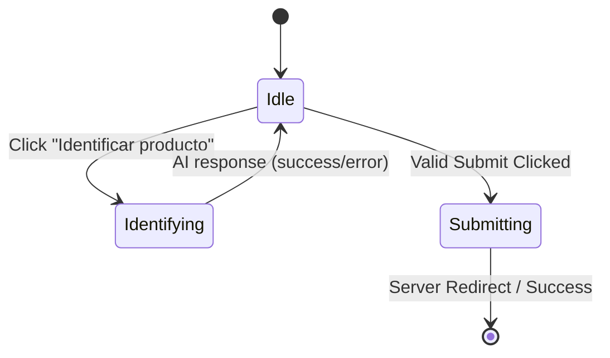

# Product Requirements Document (PRD): Intake Form Async Protection, Double-Submit Prevention & Client-Side Validation

## 1. Executive Summary
Provide robust frontend state management, asynchronous operation blocking, double-submit protection, and accessible client-side validations for the mobile product intake form (`/intake/`).

During intake, assistants upload multiple high-resolution photos and frequently trigger asynchronous operations (such as AI Vision identification) or submit large multi-part form payloads over variable mobile/Wi-Fi connections. Without explicit form state locking and client-side guards, rapid or accidental double-clicking can dispatch duplicate POST requests (creating duplicate product records), cause race conditions between AI identification and form submission, or submit empty/invalid payloads that cause unnecessary server round-trips.

This feature introduces an explicit client-side form state machine (`idle`, `identifying`, `submitting`), disables interactive triggers during in-flight operations with clear animated feedback, prevents double-clicks, and provides accessible, non-disruptive inline error banners replacing browser `alert()` popups.

---

## 2. Problem Statement
1. **Double Submission on Slow Connections:** When an assistant clicks "Guardar y Catalogar Siguiente Artículo", multi-megabyte photo uploads take several seconds to stream. Impatient or accidental repeated taps dispatch multiple POST requests, resulting in duplicate product rows in the database.
2. **Race Conditions during AI Pre-flight:** While the asynchronous pre-flight endpoint (`/intake/identify/`) is in flight, the main submit button remains clickable. If the assistant submits the form while AI analysis is actively running, the uploaded photos are locked or cleared while the AI request is still awaiting a response.
3. **Photo Modification during Active Analysis:** Assistants can select or change file inputs while AI pre-flight is reading the previous selection, creating inconsistent analysis states.
4. **Poor Mobile Validation UX:** The file input uses HTML5 `required`, which triggers browser-specific tooltips that can be clipped, invisible, or ignored on various mobile browsers. Furthermore, selecting >10 images triggers a native JavaScript `alert()`, which halts the JavaScript thread and degrades the mobile user experience.
5. **No Client-Side File Size Protection:** Uploading files larger than 10MB only fails after the entire payload finishes uploading to the server, wasting mobile data and bandwidth.

---

## 3. User Personas & Scenarios

### Persona: Sourcing Assistant (User A)
- **Scenario 1 (Double-Click Prevention):** The assistant taps "Guardar y Catalogar Siguiente Artículo" on 3 photos over a 3G warehouse connection. The submit button immediately disables, turns into a loading state with a spinning SVG, and changes text to *"Guardando producto..."*. Tapping repeatedly has no effect, preventing duplicate product records.
- **Scenario 2 (Safe AI Identification):** The assistant selects 2 photos and taps "Identificar producto". While the AI vision request runs, the main submit button and dropzone are temporarily locked with clear visual indication (*"Espera a que finalice el análisis con IA..."*). Once the advisory banner appears, the submit button reactivates.
- **Scenario 3 (Instant Validation without Jarring Popups):** The assistant accidentally selects 12 photos. Instead of a blocking browser `alert()`, a smooth, accessible amber warning appears inline above the dropzone explaining that the maximum is 10 photos, without freezing the browser.
- **Scenario 4 (Oversized File Catch):** The assistant attempts to attach a 15MB RAW camera file. The client checks `file.size` instantly and displays an accessible message: *"El archivo 'DSC_001.JPG' supera el límite de 10MB (15.2 MB). Por favor, elige una foto más pequeña."*

---

## 4. Scope & Technical Architecture

### 4.1 Form State Machine (`formState`)
The intake form controller on `intake.html` manages three discrete states:

| State | `#identifyBtn` | `#submitBtn` | Dropzone / Inputs | Visual Feedback |
|---|---|---|---|---|
| `idle` | Active (if files >= 1) | Active | Interactive | Standard UI |
| `identifying` | Disabled, spinner | Disabled (`opacity-60 cursor-not-allowed`) | Dropzone locked (`pointer-events-none opacity-70`) | "Analizando fotos con IA..." |
| `submitting` | Disabled | Disabled (`cursor-not-allowed opacity-75`) | Form inputs locked (`pointer-events-none`) | "Guardando producto..." with spinner |

### 4.2 Double-Submit Guard
- Introduce a boolean guard `let isSubmitting = false;` in the intake script.
- On the form's `submit` event listener:
  - If `isSubmitting` is true, immediately call `e.preventDefault()` and return false.
  - If validation passes, set `isSubmitting = true`, update button text/spinner, and allow the submission to proceed.
  - If client validation fails, set `isSubmitting = false`, restore button state, and display inline error.

### 4.3 Accessible Client-Side Validations
1. **Zero Photos Guard:**
   - Intercepts submit before network transmission.
   - If `imageInput.files.length === 0`:
     - Displays accessible alert banner (`#intakeClientAlert`) with `role="alert"` and `aria-live="polite"`.
     - Adds temporary error ring to `#dropZone` (`border-rose-400 ring-2 ring-rose-200 bg-rose-50/40`).
     - Smoothly scrolls to `#dropZone`.
2. **File Count Guard (> 10 photos):**
   - Replaces `alert()` with inline alert inside `#intakeClientAlert`.
   - Clears selection and resets photo counter.
3. **File Size Guard (> 10MB per image):**
   - Iterates through `files` inspecting `file.size > 10 * 1024 * 1024`.
   - Flags oversized files with clear filename and calculated size in MB.
4. **Target Sale Price Guard:**
   - Validates that numeric input is >= 0 and within `9999999.99` bounds if provided.

### 4.4 Internationalization (i18n)
New client messages localized with ``:
- *"Please attach at least one photo of the product before saving."* / *"Por favor, adjunta al menos una foto del producto antes de guardar."*
- *"You have selected more than %(max)s photos. Please select up to %(max)s images."* / *"Has seleccionado más de %(max)s fotos. Por favor, selecciona un máximo de %(max)s imágenes."*
- *"The file '%(name)s' exceeds the 10MB limit (%(size)s MB)."* / *"El archivo '%(name)s' supera el límite de 10MB (%(size)s MB)."*
- *"Saving product..."* / *"Guardando producto..."*
- *"Please wait for AI analysis to finish..."* / *"Espera a que finalice el análisis con IA..."*

---

## 5. Non-Functional Requirements
- **WCAG 2.1 AA Accessibility:** Alerts use `role="alert"` and `aria-live="polite"`; form elements maintain visible focus indicators; buttons maintain min 44x44px touch targets.
- **Zero External Dependencies:** Implemented with pure vanilla JavaScript matching the existing lightweight architecture.
- **Graceful Error Recovery:** Any unexpected exception during async fetch or validation resets `formState` back to `'idle'` so the user is never permanently stuck or locked out.

---

## 6. Success Metrics & Acceptance Criteria
1. Double-clicking the "Guardar producto" button never creates duplicate records or duplicate HTTP POST requests.
2. Triggering AI pre-flight locks the submit button and dropzone until the analysis resolves or fails.
3. Submitting 0 photos produces a clear inline error without relying solely on native browser tooltips.
4. Attempting to upload >10 photos or >10MB files triggers a clean inline notification without browser `alert()` popups.
5. All automated unit and browser tests pass with 0 regressions.
