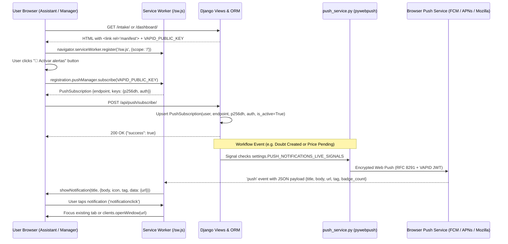

# Product Requirements Document (PRD) & Specification
# Installable PWA Support & Web Push Notification Foundation

## 1. Objective

Transform **2ndHand Staging** into an installable, native-feeling Progressive Web App (PWA) for both **Assistants** (mobile intake & answering clarification doubts) and **Managers** (staging, pricing, and reviewing), while establishing a complete, standards-based **VAPID Web Push Notification** infrastructure with an environment-controlled live signal trigger (`PUSH_NOTIFICATIONS_LIVE_SIGNALS`):

1. **Installable Zero-Cache Pass-Through PWA:**
   - Provide a valid Web App Manifest (`/manifest.json`), PWA & iOS Safari meta tags (`theme-color`, `apple-mobile-web-app-capable`), and multi-resolution app icons (`192x192`, `512x512`, and `180x180` Apple Touch Icon).
   - Serve a root-scoped Service Worker (`/sw.js`) with a pass-through `fetch` handler that satisfies browser PWA installability criteria across Android Chrome, Desktop Chrome/Edge, and iOS Safari Home Screen (`standalone` mode) **without caching dynamic Django HTML or CSRF tokens**.
2. **Standards-Based VAPID Web Push Infrastructure (`pywebpush`):**
   - Create the `PushSubscription` model storing per-device W3C Push API subscription endpoints and encryption keys (`endpoint`, `p256dh`, `auth`, `user_agent`, `is_active`) linked to `User`.
   - Configure VAPID keys (`VAPID_PUBLIC_KEY`, `VAPID_PRIVATE_KEY`, `VAPID_CLAIMS_EMAIL`) in `config/settings.py` and `.env.example`, paired with a `generate_vapid_keys` management command.
   - Implement `inventory/services/push_service.py` with `send_push_to_user()` and `send_push_to_group()` helpers, automatic HTTP `404`/`410 Gone` dead-subscription pruning, OS notification `tag` collapsing, and non-blocking error handling.
3. **Subscription API, UI Toggle & `.env` Live Signal Triggers:**
   - Expose authenticated JSON endpoints (`/api/push/subscribe/`, `/api/push/unsubscribe/`, `/api/push/test/`) and an accessible **"🔔 Notifications"** toggle button in both the desktop navbar and mobile hamburger drawer (including an iOS non-standalone helper hint and App Badging API synchronization).
   - Wire Django model signals guarded by the `.env` flag `PUSH_NOTIFICATIONS_LIVE_SIGNALS=True|False` to automatically dispatch push notifications for:
     - **Clarification Doubts Q&A:** Manager asks a question (`PENDING`) → notifies `assistants` group; Assistant answers (`ANSWERED`) → notifies `managers` group.
     - **Intake & Lifecycle Bottlenecks:** New product enters `DRAFT` or transitions into `PRICE_PENDING` → notifies `managers` group.

---

## 2. Tech Stack & Dependencies

- **Backend:** Python 3.13, Django 5.1+
- **Web Push Protocol:** `pywebpush>=2.0.1` (RFC 8030 Web Push + RFC 8292 VAPID ECDSA P-256 signing + RFC 8291 `aes128gcm` payload encryption)
- **Database:** SQLite (local/dev) / PostgreSQL (production) via Django ORM
- **Frontend & Browser APIs:** Django Templates, Tailwind CSS, Vanilla JavaScript, W3C Service Worker API, PushManager API, Notifications API, Badging API (`navigator.setAppBadge`)
- **Internationalization (i18n):** Bilingual support (Spanish `es` default, English `en`) via Django `gettext`

---

## 3. Executable Commands

- **Install Dependencies:** `.venv\Scripts\pip.exe install -r requirements.txt`
- **Generate VAPID Keys:** `.venv\Scripts\python.exe manage.py generate_vapid_keys`
- **Run Migrations:** `.venv\Scripts\python.exe manage.py makemigrations inventory && .venv\Scripts\python.exe manage.py migrate`
- **Compile Translations:** `.venv\Scripts\python.exe manage.py compile_locales`
- **Run Targeted PWA/Push Tests:** `.venv\Scripts\python.exe manage.py test tests.test_pwa_push -v 2`
- **Run Full Test Suite:** `.venv\Scripts\python.exe manage.py test`
- **Run Linter:** `.venv\Scripts\ruff.exe check .`

---

## 4. Project Structure & Affected Modules

```text
config/
└── settings.py                                    # VAPID_PUBLIC_KEY, VAPID_PRIVATE_KEY, VAPID_CLAIMS_EMAIL, PUSH_NOTIFICATIONS_LIVE_SIGNALS
inventory/
├── models.py                                      # PushSubscription model + signal hooks for Doubts & Lifecycle bottlenecks
├── admin.py                                       # PushSubscriptionAdmin with "Send test push notification" action
├── views.py                                       # manifest_view, service_worker_view, push_subscribe_view, push_unsubscribe_view, push_test_view
├── urls.py                                        # /manifest.json, /sw.js, /api/push/subscribe/, /api/push/unsubscribe/, /api/push/test/
├── context_processors.py                          # Inject VAPID_PUBLIC_KEY and user push subscription status into template context
├── services/
│   └── push_service.py                            # VAPID Web Push dispatcher, group fan-out, 404/410 cleanup, payload builder
├── management/commands/
│   └── generate_vapid_keys.py                     # CLI utility to generate ECDSA P-256 VAPID keypairs for .env
├── static/inventory/icons/
│   ├── icon-192.png                               # 192x192 PWA standard & maskable icon
│   ├── icon-512.png                               # 512x512 PWA splash & store icon
│   └── apple-touch-icon.png                       # 180x180 iOS Home Screen icon
├── templates/inventory/
│   ├── base.html                                  # Manifest link, PWA meta tags, SW registration, Notification toggle UI & JS
│   └── sw.js                                      # Root Service Worker (pass-through fetch, push display, notificationclick routing)
├── migrations/
│   └── 0013_pushsubscription.py                   # Database migration for PushSubscription
locale/
└── es/LC_MESSAGES/django.po                       # Spanish translations for PWA & Push UI strings
tests/
└── test_pwa_push.py                               # Unit, view, signal, and Service Worker / browser verification tests
```

---

## 5. Detailed Functional Requirements & Architecture

### 5.1 Architecture & Push Delivery Flow



### 5.2 PWA Manifest (`/manifest.json`) & Root Service Worker (`/sw.js`)

1. **Web App Manifest (`/manifest.json`):**
   - Served dynamically via `manifest_view` with `Content-Type: application/manifest+json`.
   - Properties:
     - `name`: `"2ndHand Staging Hub"`
     - `short_name`: `"2ndHand"`
     - `start_url`: `"/"`
     - `scope`: `"/"`
     - `display`: `"standalone"`
     - `background_color`: `"#f8fafc"` (`slate-50`)
     - `theme_color`: `"#059669"` (`emerald-600`)
     - `icons`: `192x192` (`any` and `maskable`) and `512x512` (`any` and `maskable`).
2. **Root-Scoped Pass-Through Service Worker (`/sw.js`):**
   - Served at `/sw.js` with headers `Content-Type: application/javascript`, `Service-Worker-Allowed: /`, and `Cache-Control: no-cache, no-store, must-revalidate`.
   - **Zero Caching Policy:** The `fetch` listener strictly passes requests through to the network (`return;`), avoiding any caching of HTML pages or CSRF tokens.
   - **`push` Event Listener:**
     - Parses incoming JSON payload (`{ title, body, url, tag, icon, badge_count }`) with safe fallback if plain text is received.
     - Calls `self.registration.showNotification(title, options)` using `tag` to collapse/replace duplicate notifications in the device tray.
     - If `badge_count` is provided and `self.navigator && 'setAppBadge' in self.navigator`, updates the OS home screen icon badge.
   - **`notificationclick` Event Listener:**
     - Closes the clicked notification (`event.notification.close()`).
     - Inspects `clients.matchAll({ type: 'window', includeUncontrolled: true })`: if a client window on the same origin is already open, navigates/focuses it; otherwise calls `clients.openWindow(targetUrl)`.

### 5.3 Domain Model: `PushSubscription`

```python
class PushSubscription(models.Model):
    user = models.ForeignKey(
        settings.AUTH_USER_MODEL,
        on_delete=models.CASCADE,
        related_name="push_subscriptions",
    )
    endpoint = models.URLField(max_length=1000, unique=True)
    p256dh = models.CharField(max_length=255)
    auth = models.CharField(max_length=255)
    user_agent = models.CharField(max_length=500, blank=True, default="")
    is_active = models.BooleanField(default=True)
    created_at = models.DateTimeField(auto_now_add=True)
    updated_at = models.DateTimeField(auto_now=True)
```

### 5.4 Environment Configuration (`.env` & `config/settings.py`)

New environment variables added to `.env.example` and loaded in `config/settings.py`:
- `VAPID_PUBLIC_KEY`: Base64URL-encoded uncompressed ECDSA P-256 public key (65 bytes -> 87 chars).
- `VAPID_PRIVATE_KEY`: Base64URL-encoded or PEM private key.
- `VAPID_CLAIMS_EMAIL`: Contact URI for VAPID `sub` claim (default: `"mailto:admin@2ndhand.local"`).
- `PUSH_NOTIFICATIONS_LIVE_SIGNALS`: Boolean flag (`True` / `False`, default `False` in base config, configurable in `.env`) controlling whether model signals automatically dispatch live Web Push notifications.

### 5.5 Push Notification Service (`inventory/services/push_service.py`) & Signal Triggers

1. **Core Helper Functions:**
   - `is_push_configured() -> bool`: Returns `True` when `VAPID_PUBLIC_KEY` and `VAPID_PRIVATE_KEY` are both non-empty.
   - `send_push_to_subscription(subscription: PushSubscription, payload: dict) -> bool`: Sends encrypted Web Push via `pywebpush.webpush()`. If `WebPushException` returns HTTP `404` or `410`, deletes the expired `PushSubscription` record automatically. Catches and logs all exceptions so callers never crash.
   - `send_push_to_user(user, title: str, body: str, url: str = "/", tag: str = "general", badge_count: int | None = None) -> int`: Sends payload to all active `PushSubscription` records for `user`. Returns count of successful deliveries.
   - `send_push_to_group(group_name: str, title: str, body: str, url: str = "/", tag: str = "general", exclude_user=None) -> int`: Sends payload to all active users belonging to `group_name` (or superusers/staff if `group_name == "managers"`), excluding `exclude_user` if specified so users don't notify themselves.
2. **Live Signal Triggers (when `settings.PUSH_NOTIFICATIONS_LIVE_SIGNALS=True`):**
   - **Clarification Doubts Q&A (`ProductClarification` post_save):**
     - **New Pending Doubt:** Dispatches push to `"assistants"` group:
       - Title: `"❓ Nueva duda en {product.display_title}"`
       - Body: `clarification.question` (truncated to 120 chars)
       - URL: `/products/{product.pk}/`
       - Tag: `f"clarification-{product.pk}"`
     - **Doubt Answered:** When status transitions from `PENDING` to `ANSWERED`, dispatches push to `"managers"` group:
       - Title: `"✅ Duda resuelta: {product.display_title}"`
       - Body: `clarification.answer` (truncated to 120 chars)
       - URL: `/products/{product.pk}/`
       - Tag: `f"clarification-{product.pk}"`
   - **Intake & Lifecycle Bottlenecks (`Product` post_save):**
     - **New Product Intake (`DRAFT`):** When a product is newly created (`created=True`), dispatches push to `"managers"` group (excluding `product.created_by` if manager):
       - Title: `"📦 Nuevo producto en borrador"`
       - Body: `f"{product.display_title} está listo para revisión."`
       - URL: `/products/{product.pk}/`
       - Tag: `"intake-draft"`
     - **Transition to `PRICE_PENDING`:** When an existing product transitions into `ProductStatus.PRICE_PENDING` (`prev_status != PRICE_PENDING`), dispatches push to `"managers"` group:
       - Title: `"🏷️ Precio pendiente: {product.display_title}"`
       - Body: `"El producto tiene título y descripción y espera precio de venta."`
       - URL: `/products/{product.pk}/`
       - Tag: `f"price-pending-{product.pk}"`

### 5.6 Client UI & Navbar/Drawer Controls

- **Desktop Navbar & Mobile Drawer (`base.html`):**
  - Renders a compact notification status/toggle button (`#push-toggle-btn` on desktop, `#mobile-push-toggle-btn` in the mobile drawer) when the user is authenticated.
  - States:
    - **Unsubscribed / Default:** `🔔 Activar alertas` (`Enable Alerts`)
    - **Subscribed:** `🔔 Alertas activas` (`Alerts Active`) with emerald styling
    - **iOS Non-Standalone Hint:** If running on iOS (`iPhone|iPad|iPod`) outside `standalone` mode and `PushManager` is unavailable, clicking displays an inline non-blocking toast/banner explaining: *"En iPhone/iPad, pulsa Compartir → Añadir a pantalla de inicio para activar las notificaciones push."*
- **App Icon Badging Sync:**
  - On page load in `base.html`, if `'setAppBadge' in navigator`, synchronizes `pending_clarifications_count` (calls `navigator.setAppBadge(count)` when `count > 0`, or `navigator.clearAppBadge()` when `0`).

---

## 6. Code Style & Example Snippet

```python
# inventory/services/push_service.py
import json
import logging
from django.conf import settings
from pywebpush import WebPushException, webpush
from inventory.models import PushSubscription

logger = logging.getLogger(__name__)


def is_push_configured() -> bool:
    return bool(
        getattr(settings, "VAPID_PUBLIC_KEY", "")
        and getattr(settings, "VAPID_PRIVATE_KEY", "")
    )


def send_push_to_subscription(subscription: PushSubscription, payload: dict) -> bool:
    if not is_push_configured() or not subscription.is_active:
        return False

    try:
        webpush(
            subscription_info={
                "endpoint": subscription.endpoint,
                "keys": {
                    "p256dh": subscription.p256dh,
                    "auth": subscription.auth,
                },
            },
            data=json.dumps(payload),
            vapid_private_key=settings.VAPID_PRIVATE_KEY,
            vapid_claims={"sub": getattr(settings, "VAPID_CLAIMS_EMAIL", "mailto:admin@2ndhand.local")},
            timeout=5,
        )
        return True
    except WebPushException as exc:
        status_code = getattr(exc.response, "status_code", None)
        if status_code in (404, 410):
            logger.info("Pruning expired PushSubscription id=%s (HTTP %s)", subscription.pk, status_code)
            subscription.delete()
        else:
            logger.warning("WebPush delivery failed for id=%s: %s", subscription.pk, exc)
        return False
    except Exception as exc:
        logger.warning("Unexpected error sending WebPush for id=%s: %s", subscription.pk, exc)
        return False
```

---

## 7. Testing Strategy

1. **PWA Manifest & Service Worker View Tests (`tests/test_pwa_push.py`):**
   - Verify `GET /manifest.json` returns HTTP 200, `application/manifest+json`, valid JSON structure, `display: "standalone"`, and valid icon paths.
   - Verify `GET /sw.js` returns HTTP 200, `application/javascript`, header `Service-Worker-Allowed: /`, and contains `push`, `notificationclick`, and pass-through `fetch` listeners.
   - Verify `base.html` includes `<link rel="manifest" href="/manifest.json">`, `theme-color`, and `apple-touch-icon`.
2. **Subscription Model & API Endpoint Tests (`tests/test_pwa_push.py`):**
   - Verify `POST /api/push/subscribe/` requires authentication, validates payload keys (`endpoint`, `keys.p256dh`, `keys.auth`), creates `PushSubscription`, and idempotently updates existing endpoints when re-subscribed.
   - Verify `POST /api/push/unsubscribe/` removes/deactivates the user's subscription and prevents deleting another user's subscription.
   - Verify `POST /api/push/test/` triggers `send_push_to_user` for the logged-in user.
3. **Push Service & Dead Subscription Pruning Tests (`tests/test_pwa_push.py`):**
   - Mock `pywebpush.webpush` to verify payload structure, VAPID claims, group fan-out (`assistants` vs `managers`), and automatic deletion of `PushSubscription` when `WebPushException` returns HTTP `410 Gone` or `404 Not Found`.
4. **Live Signal Trigger Tests (`tests/test_pwa_push.py`):**
   - Verify that when `PUSH_NOTIFICATIONS_LIVE_SIGNALS=False`, model saves do not invoke `webpush`.
   - Verify that under `@override_settings(PUSH_NOTIFICATIONS_LIVE_SIGNALS=True)`:
     - Creating a pending `ProductClarification` notifies `assistants`.
     - Answering a `ProductClarification` notifies `managers`.
     - Creating a `DRAFT` product or transitioning a product to `PRICE_PENDING` notifies `managers`.
5. **Management Command Test (`tests/test_pwa_push.py`):**
   - Verify `call_command("generate_vapid_keys")` outputs valid Base64URL `VAPID_PUBLIC_KEY` and `VAPID_PRIVATE_KEY` strings.

---

## 8. Boundaries

- **Always:** Keep Web Push dispatch non-blocking with short timeouts (`timeout=5`) and comprehensive `try/except` guards so push failures never break or slow down product saves or clarification actions; run `ruff check .` and full test suite before committing.
- **Ask first:** Introducing background queue brokers (Celery/Redis) or third-party push SDKs.
- **Never:** Commit real production `VAPID_PRIVATE_KEY` secrets to version control, cache dynamic HTML responses or CSRF tokens in `/sw.js`, or trigger `Notification.requestPermission()` automatically on page load without an explicit user click.

---

## 9. Success Criteria

1. [ ] `GET /manifest.json` and `GET /sw.js` serve valid PWA manifest and root-scoped pass-through Service Worker with `Service-Worker-Allowed: /`.
2. [ ] Static PWA icons (`icon-192.png`, `icon-512.png`, `apple-touch-icon.png`) exist and are linked in `base.html` alongside PWA meta tags.
3. [ ] `PushSubscription` model and migration `0013_pushsubscription.py` are created and registered in Django Admin with a "Send test push notification" action.
4. [ ] `python manage.py generate_vapid_keys` generates a valid ECDSA P-256 VAPID keypair ready for `.env`.
5. [ ] Authenticated users can subscribe, unsubscribe, and send a test notification via `/api/push/subscribe/`, `/api/push/unsubscribe/`, and `/api/push/test/`, with UI toggle buttons in the desktop navbar and mobile drawer.
6. [ ] `push_service.py` sends encrypted Web Push payloads via `pywebpush` and automatically prunes expired subscriptions returning HTTP `404` or `410 Gone`.
7. [ ] Setting `PUSH_NOTIFICATIONS_LIVE_SIGNALS=True` automatically dispatches targeted push alerts on Clarification Doubts Q&A (`PENDING` / `ANSWERED`) and Lifecycle bottlenecks (`DRAFT` creation / `PRICE_PENDING` transition).
8. [ ] All existing 281 tests + new PWA/Push tests pass (`python manage.py test`) and `ruff check .` reports 0 errors.

---

## 10. Decisions & Validated Specifications

1. **Dual-Role Target Audience:** Both Assistants (mobile cataloging & answering doubts) and Managers (staging, pricing & reviewing) can install the PWA and subscribe to push notifications.
2. **Pass-Through Service Worker (No Offline Caching):** `/sw.js` implements a pass-through `fetch` handler strictly for PWA installability and Web Push handling, avoiding stale inventory pages or broken Django CSRF tokens.
3. **Environment-Controlled Signal Trigger (`PUSH_NOTIFICATIONS_LIVE_SIGNALS`):** Live signal dispatch for Clarification Doubts and Draft/Price Pending bottlenecks is wired and controlled via `PUSH_NOTIFICATIONS_LIVE_SIGNALS` in `.env` / `config/settings.py`.
