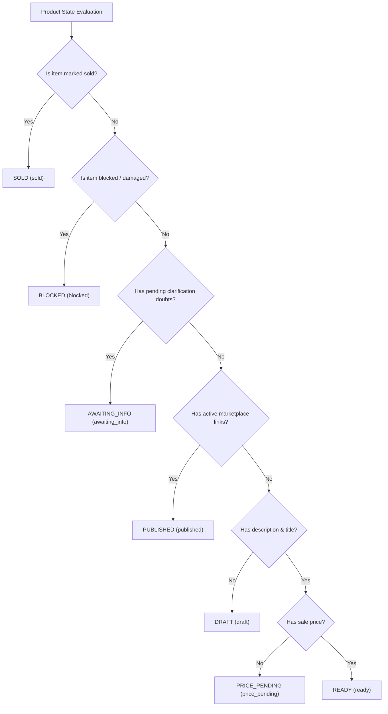

# Product Requirements Document (PRD) & Specification
# Refined Product Lifecycle States, Dashboard Filtering & Intake AI Title Autofill

## 1. Objective

Refine the commercial lifecycle state machine for products in the 2ndHand Staging Hub and enhance the intake screen with intelligent AI title autofill:
1. **Granular Lifecycle State Automation:**
   - **`DRAFT` (`draft`):** The initial state when a product has no description (`ai_description` is blank or empty).
   - **`PRICE_PENDING` (`price_pending`):** State when a product has both a title (`ai_title`) and a description (`ai_description`), but lacks a valid sale price (`sale_price is None` or 0).
   - **`READY` (`ready`):** State when a product has title, description, and sale price, ready to be listed across marketplaces.
   - **`PUBLISHED` (`published`):** State automatically triggered when any active marketplace listing link (`ProductListingLink`) is attached to the product.
   - **Preserved Existing States:** `AWAITING_INFO` (pending clarification doubts from manager), `SOLD` (commercial sale finalized), and `BLOCKED` (rejected / damaged).
   - All state transitions must be **fully automatic** upon product saves and listing link modifications.
2. **Intake Screen AI Title Autofill:**
   - Use the pre-flight **"Identificar producto"** button to automatically populate the product title (`ai_title`) in the intake form, eliminating generic fallback titles (e.g., *"Producto #93"* or raw note truncations) when cataloging items.
   - Upgrade the intake AI vision identification model to **`gemini-flash-latest`**.
3. **Control Panel / Dashboard Filtering:**
   - Add a dedicated **"Precio pendiente"** filter button/tab with dynamic counter badge to the main dashboard catalog view (`/dashboard/?status=price_pending`), allowing managers to immediately spot and price ready items.

---

## 2. Tech Stack & Dependencies

- **Backend:** Python 3.13, Django 5.1+
- **Database:** SQLite (local/dev) / PostgreSQL (production) with Django ORM
- **AI Vision Engine:** Google GenAI SDK (`google-genai`), model `gemini-flash-latest` for intake pre-flight identification
- **Frontend:** Django Templates, Tailwind CSS, Vanilla JavaScript (DOM manipulation and fetch API)
- **Internationalization (i18n):** Bilingual support (Spanish `es` default, English `en`) via Django `gettext`

---

## 3. Executable Commands

- **Run Dev Server:** `.venv\Scripts\python.exe manage.py runserver 127.0.0.1:8000`
- **Run Migrations:** `.venv\Scripts\python.exe manage.py makemigrations inventory && .venv\Scripts\python.exe manage.py migrate`
- **Run Full Test Suite:** `.venv\Scripts\python.exe manage.py test`
- **Run Targeted Tests:** `.venv\Scripts\python.exe manage.py test inventory.tests.test_lifecycle inventory.tests.test_dashboard`
- **Compile Messages:** `.venv\Scripts\python.exe manage.py compilemessages`

---

## 4. Project Structure & Affected Modules

```
inventory/
├── models.py                  # ProductStatus choices (add PRICE_PENDING, PUBLISHED), Product.compute_lifecycle_status(), signals
├── forms.py                   # ProductIntakeForm (add ai_title field), ProductUpdateForm
├── views.py                   # ProductIntakeView, dashboard_view (status=price_pending, counts), intake_identify_view
├── services/
│   └── ai_service.py          # INTAKE_IDENTIFICATION_MODEL_NAME = "gemini-flash-latest"
├── templates/inventory/
│   ├── intake.html            # Render title field, JS auto-populates title on identify success
│   ├── dashboard.html         # Add 'Precio pendiente' filter button and badge counter
│   └── product_detail.html    # Status badge styling for PRICE_PENDING and PUBLISHED
├── migrations/
│   └── 0012_*.py              # Migration for new ProductStatus choices and data sync
locale/
├── es/LC_MESSAGES/django.po   # Translations for "Price Pending", "Published", filter buttons
└── en/LC_MESSAGES/django.po   # English source strings
```

---

## 5. Detailed Functional Requirements & State Machine

### 5.1 Product Lifecycle State Hierarchy & Precedence

The automatic state calculation rules evaluate with the following strict business precedence:



1. **`SOLD` (`sold`):** Terminal commercial state (`is_sold=True` or `status=SOLD`).
2. **`BLOCKED` (`blocked`):** Explicit administrative block for damaged/unsellable items.
3. **`AWAITING_INFO` (`awaiting_info`):** Manager has opened a clarification question awaiting assistant response.
4. **`PUBLISHED` (`published`):** Product has at least one active `ProductListingLink` (`product.listing_links.filter(is_active=True).exists()`).
5. **`READY` (`ready`):** Product has non-empty `ai_title`, non-empty `ai_description`, and non-empty `sale_price` (> 0), with zero marketplace links.
6. **`PRICE_PENDING` (`price_pending`):** Product has non-empty `ai_title` and non-empty `ai_description`, but `sale_price` is missing or None.
7. **`DRAFT` (`draft`):** Product lacks a description (`ai_description` is blank or empty).

### 5.2 Automatic State Synchronization Triggers

State transitions occur automatically without requiring manual dropdown selection:
- **`Product.save()`:** Evaluates `compute_lifecycle_status()` whenever title, description, price, or `is_sold` is modified.
- **`ProductListingLink` (`post_save` & `post_delete` signals):** Adding the first active link auto-promotes the product to `PUBLISHED`. Deleting or deactivating all links recalculates the state back to `READY`, `PRICE_PENDING`, or `DRAFT`.
- **`ProductClarification` (`post_save` & `post_delete` signals):** When all pending clarifications are resolved or deleted, the product transitions out of `AWAITING_INFO` into its computed state (`PUBLISHED`, `READY`, `PRICE_PENDING`, or `DRAFT`).

### 5.3 Intake Screen Enhancements

1. **Field Addition:** Expose `ai_title` in `ProductIntakeForm` as an editable text input:
   - Label: *"Listing Title / Título"* (optional for assistant, but populated automatically when identified).
   - Placeholder: *"e.g. Chaqueta Cuero Schott Perfecto 90s Vintage..."*
2. **On-Demand Identification Button Action:**
   - Assistant clicks **"Identificar producto"**.
   - Endpoint `/inventory/intake/identify/` invokes Gemini using **`gemini-flash-latest`**.
   - Upon receiving JSON response with `identified_title`:
     - Populates the `#id_ai_title` input field automatically.
     - Displays visual feedback indicating title filled from AI detection.
     - Sourcing assistant can keep, refine, or edit the title before submitting.
3. **Submission Behavior:**
   - When saved, `Product.ai_title` is persisted immediately.
   - Products no longer generate generic titles like *"Producto #89"*; they display the identified brand and item name in recent uploads and the dashboard.

### 5.4 Dashboard Filtering & Controls

1. **Filter Tab Addition:**
   - In `/dashboard/`, add **`Precio pendiente` / `Price Pending`** filter button:
     - URL parameter: `?status=price_pending`
     - Counter badge: `({{ price_pending_count }})`
     - Scoped to active platform filters and search queries.
2. **Status Count Aggregation:**
   - Add `price_pending_count` to the aggregate query in `dashboard_view`.
   - Update `active_count` logic: active items include all unsold non-blocked items (`is_sold=False` and `status != BLOCKED`).

---

## 6. Code Style & Example Snippet

```python
# inventory/models.py

class ProductStatus(models.TextChoices):
    DRAFT = "draft", _("Draft")
    PRICE_PENDING = "price_pending", _("Price Pending")
    READY = "ready", _("Ready to Publish")
    PUBLISHED = "published", _("Published")
    AWAITING_INFO = "awaiting_info", _("Awaiting Info")
    SOLD = "sold", _("Sold")
    BLOCKED = "blocked", _("Blocked")


class Product(models.Model):
    ...
    def compute_lifecycle_status(self) -> str:
        if self.is_sold or self.status == ProductStatus.SOLD:
            return ProductStatus.SOLD
        if self.status == ProductStatus.BLOCKED:
            return ProductStatus.BLOCKED
        if self.clarifications.filter(status=ClarificationStatus.PENDING).exists():
            return ProductStatus.AWAITING_INFO
        if self.listing_links.filter(is_active=True).exists():
            return ProductStatus.PUBLISHED
        
        has_title = bool((self.ai_title or "").strip())
        has_description = bool((self.ai_description or "").strip())
        has_price = self.sale_price is not None and self.sale_price > Decimal("0.00")

        if not has_description:
            return ProductStatus.DRAFT
        if has_title and has_description and not has_price:
            return ProductStatus.PRICE_PENDING
        if has_title and has_description and has_price:
            return ProductStatus.READY

        return ProductStatus.DRAFT
```

---

## 7. Testing Strategy

1. **Unit Tests (`inventory/tests/test_lifecycle.py`):**
   - Test item without description defaults to `DRAFT`.
   - Test item with title + description but no price transitions to `PRICE_PENDING`.
   - Test adding price to `PRICE_PENDING` item transitions to `READY`.
   - Test adding marketplace link transitions to `PUBLISHED`.
   - Test removing all links reverts from `PUBLISHED` to `READY` (or `PRICE_PENDING`).
   - Test clarification doubts correctly take precedence and revert to computed state when resolved.
2. **Intake Form & AI Tests (`inventory/tests/test_intake.py`):**
   - Test `identify_intake_product` invokes `gemini-flash-latest`.
   - Test intake form saves `ai_title` when submitted.
3. **Dashboard View Tests (`inventory/tests/test_dashboard.py`):**
   - Test filtering by `?status=price_pending` displays only price-pending items.
   - Test `price_pending_count` updates dynamically.
4. **End-to-End Browser Verification:**
   - Execute real Google Chrome verification covering intake with AI title fill, price-pending status transition, dashboard filter button click, link publishing, and sale marking.

---

## 8. Boundaries

- **Always:** Run the full test suite before and after changes; maintain backward compatibility with `is_sold` and existing signals.
- **Ask first:** Any destructive database operations or external API schema alterations.
- **Never:** Remove existing test cases or disable automated Turnstile / auth safeguards.

---

## 9. Success Criteria

1. [ ] Products without descriptions automatically remain in or transition to `DRAFT`.
2. [ ] Products with title + description but without a price automatically transition to `PRICE_PENDING`.
3. [ ] Products with at least one active marketplace link automatically transition to `PUBLISHED`.
4. [ ] Deleting/unlinking all marketplace links automatically recalculates status back to `READY`, `PRICE_PENDING`, or `DRAFT`.
5. [ ] The intake AI identification endpoint uses `gemini-flash-latest`.
6. [ ] Clicking "Identificar producto" on intake screen fills the `ai_title` field with the AI-detected title.
7. [ ] The dashboard catalog includes a **"Precio pendiente"** filter button displaying its exact live item count.
8. [ ] All 262 existing tests + new lifecycle and intake tests pass (100% green).

---

## 10. Decisions & Validated Specifications

1. **Hidden Title Field on Intake Screen:** The `ai_title` field is rendered as a hidden input (`<input type="hidden" name="ai_title" id="id_ai_title">`) on the intake screen. When the assistant taps **"Identificar producto"**, client-side JavaScript automatically sets this field with `data.identified_title` while also displaying the detected title in the banner. Upon saving, the product is created with the AI-detected title without cluttering the assistant's mobile UI.
2. **Zero Price Handling:** Any price that is `None`, empty, or numerically `<= Decimal("0.00")` is treated as "no price", triggering `PRICE_PENDING` when title and description are present.
3. **Draft to Ready Fast-Track:** If a product already had a sale price recorded during intake, adding/generating a title and description will automatically promote it directly from `DRAFT` to `READY` (bypassing `PRICE_PENDING` since price requirements are already satisfied).
